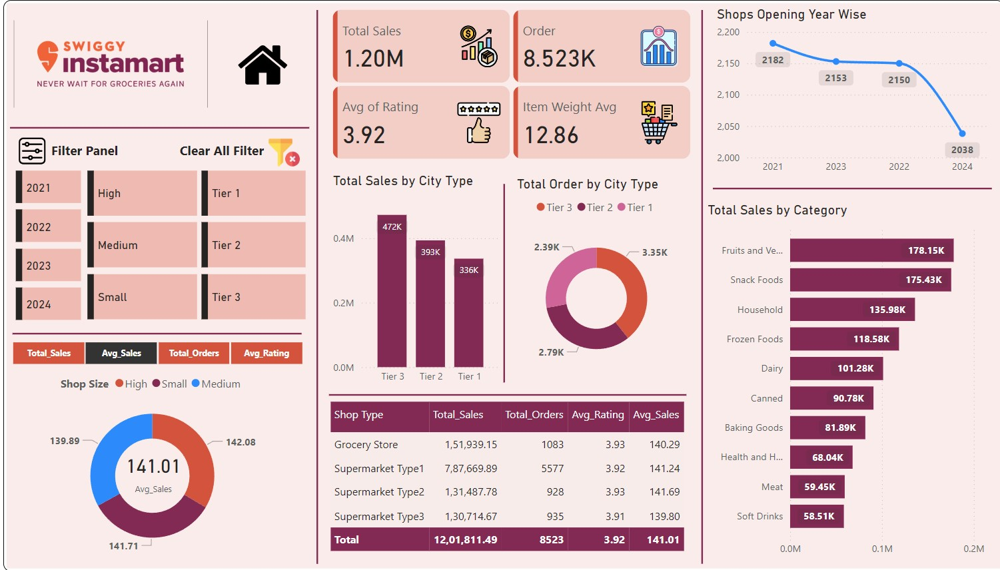

# 🛒 Instamart Data Analysis

## 📌 Project Overview

This project focuses on analyzing Instamart data to understand sales performance, customer purchasing behavior, product trends, and overall business performance.

The objective of this project is to transform raw data into meaningful insights and present the findings through data analysis and interactive visualizations.

---

## 🎯 Project Objectives

* Analyze overall sales and business performance
* Identify top-performing products and categories
* Understand customer purchasing patterns
* Analyze sales trends and product performance
* Identify important business insights from the data
* Create an easy-to-understand dashboard for decision-making

---

## 🛠️ Tools & Technologies

* **Microsoft Excel** – Data cleaning, analysis and calculations
* **SQL** – Data querying and analysis
* **Power BI** – Data visualization and dashboard development
* **Power Query** – Data transformation and cleaning

---

## 📊 Project Workflow

```text
Raw Data
   ↓
Data Cleaning & Transformation
   ↓
Data Analysis
   ↓
Data Visualization
   ↓
Dashboard
   ↓
Business Insights
```

---

## 📁 Project Structure

```text
Instamart-Data-Analysis/
│
├── Dashboard/
│   └── Final_Dashboard.jpg
│
├── Dataset/
│   ├── Instamart_Data.xlsx
│   │
│   └── uber_data/
│       ├── Dataset/
│       │   ├── New Project (83).jpg
│       │   └── uber.xlsx
│       │
│       └── Images/
│
└── Presentation/
    └── Project_1_Presentation.pptx
```

---

## 📈 Dashboard Preview



---

## 🔍 Key Analysis Areas

### Sales Analysis

* Overall sales performance
* Product-level performance
* Category-wise analysis
* Sales trends

### Product Analysis

* Top-performing products
* Product demand patterns
* Category performance

### Customer Analysis

* Customer purchasing behavior
* Order patterns
* Customer-related trends

---

## 💡 Key Insights

The analysis helps identify:

* Products and categories contributing significantly to overall performance
* Changes in sales and demand patterns
* High-performing and low-performing products
* Business areas that may require improvement
* Trends that can support better business decisions

---

## 📌 Skills Demonstrated

* Data Cleaning
* Data Transformation
* Exploratory Data Analysis
* Excel Analysis
* SQL Querying
* Power BI Dashboard Development
* Data Visualization
* Business Analysis
* Insight Generation

---

## 📂 Files Included

| File/Folder           | Description                              |
| --------------------- | ---------------------------------------- |
| `Dashboard/`          | Final dashboard image                    |
| `Dataset/`            | Project datasets                         |
| `Presentation/`       | Project presentation                     |
| `Instamart_Data.xlsx` | Main Instamart dataset                   |
| `uber.xlsx`           | Uber-related dataset used in the project |

---

## 👨‍💻 Author

**Ashish Yadav**

Aspiring Data Analyst | Excel | SQL | Python | Power BI

📍 India

---

## ⭐ Project Purpose

This project was created as part of my Data Analytics portfolio to demonstrate practical skills in data cleaning, analysis, visualization, and business insight generation.
